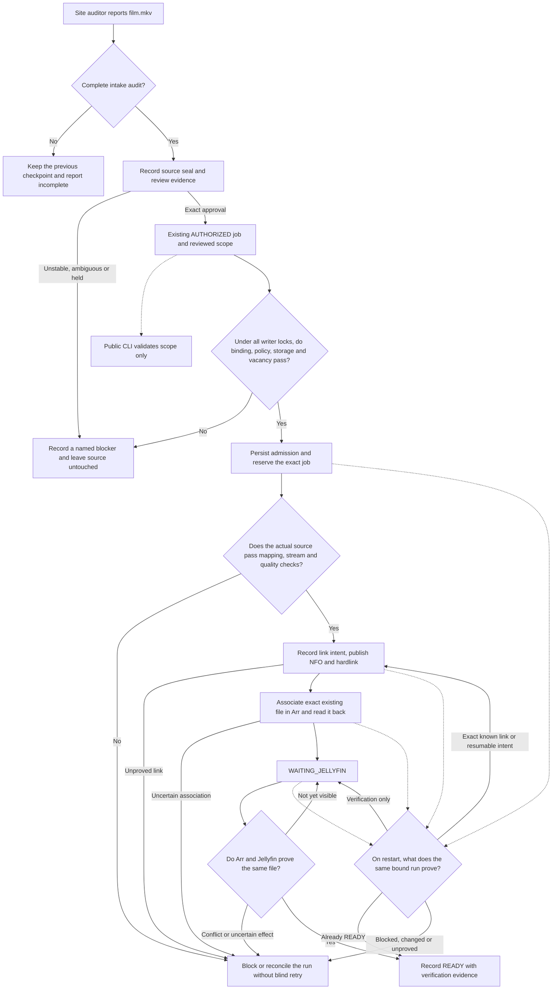

# Cal TV architecture

The public checkout inspects an existing queue and validates a reviewed scope
offline. It ships the admission, publication, and verification code so those
boundaries can be exercised with injected services. It does **not** ship the
physical auditor, deployed scheduler, credential provisioning, acquisition,
or an enabled live service transport. A scope that passes `fastpassctl validate`
has not been checked against a live library and is not authorized to run.

## Follow one file

Imagine `film.mkv` arrives in a completed intake directory for the fictional
*Synthetic Film (2000)*. Its filename alone establishes neither identity nor
fitness. The dotted exits below show offline validation or how an interrupted
operation is reconciled. The solid publication path needs a separately enabled,
authorized caller or a synthetic test fixture, never just the public CLI.



1. **Discover and review.** The caller supplies a complete inventory to
   `continuity.scan`. An incomplete audit preserves the earlier checkpoint.
   A vanished pending or leased source is blocked even after a complete audit if there
   is no receipt. The journal claims analysis with expiring leases and records
   unresolved dispositions separately from runnable work. It does not create
   import jobs or turn evidence into approval.
2. **Admit and screen.** The caller supplies a persisted job, approval, exact
   source directory, and reviewed catalogue plan. `backlog_once.run` acquires
   all four writer locks without waiting. For fresh admission it checks
   identity, policy version and digest, the external storage guard and storage
   floor, and cross-journal and library vacancy. It also checks that the source
   and nearest existing destination directory share a publication filesystem.
   Admission reserves the job in SQLite, not a byte quota. After admission,
   `importer.import_job` checks streams, duration, language, subtitle flags
   and targets before the first link. Light screening is not a full decode or content checksum.
   A separately prepared derivative still needs exact source and policy
   bindings and the same admission gates.
3. **Publish and verify.** For a new link, intent is durable before filesystem
   publication. The coordinator exposes the generated `.nfo` metadata before
   the media link so a scanner cannot see an unlabelled file first. The
   importer rechecks the filesystem and screened source before the callback
   can publish either file. Linux compares both device and mount ID, requires
   readable procfs descriptor information, and can distinguish separate bind
   mounts on one device. Other supported Unix hosts compare only device IDs.
   These are observations, not guarantees about the next syscall. The kernel
   makes the final hardlink decision. No copy fallback is attempted, and a
   late failure can leave a recorded intent or NFO to reconcile. Arr means
   Sonarr for TV or Radarr for films. It associates
   an already-linked file without moving the source. `READY` requires an exact
   Arr association and a Jellyfin item at the expected path and identity,
   with the expected default audio/subtitle behavior and a bounded server byte
   comparison. This is not a full-file playback test on a client device.
4. **Resume only from proof.** An existing link is reusable only when the
   prior intent, source identity, and destination inode agree. For a lost
   catalogue response the adapter looks for exact effects or a known command
   receipt, never resubmitting an unknown outcome. `WAITING_JELLYFIN` can
   resume verification without linking or associating again. If permitted,
   one targeted refresh can be recorded before the request and is never
   blindly resent. A supervised queue can stop before the next item without
   interrupting the current one. An explicit `BLOCKED` run needs separate
   reconciliation, not an automatic retry.

## File and role map

| Start here | What it owns |
| --- | --- |
| [fastpassctl](../fastpassctl), [fastpass.py](../media_automation/fastpass.py), [backlog_cli.py](../media_automation/backlog_cli.py) | Public offline commands, scope validation, and the guarded service-injection boundary. |
| [continuity.py](../media_automation/continuity.py), [backlog_queue.py](../media_automation/backlog_queue.py) | Different journals. Continuity tracks physical evidence. The supervised foreground queue tracks one immutable manifest of already reviewed jobs. Neither is a deployed scheduler. |
| [backlog_once.py](../media_automation/backlog_once.py), [core.py](../media_automation/core.py), [cross_journal.py](../media_automation/cross_journal.py) | One-shot worker and writer custody, native job/intent/event storage, and read-only conflict checks across journals and services. |
| [quality_policy.py](../media_automation/quality_policy.py), [speech_evidence.py](../media_automation/speech_evidence.py), [importer.py](../media_automation/importer.py) | Policy and pinned comparison evidence, source-bound language review, actual file screening, no-overwrite linking, and local provenance. |
| [light_prepare.py](../media_automation/light_prepare.py), [prepared_scope.py](../media_automation/prepared_scope.py), [scope_config.py](../media_automation/scope_config.py) | Separate stream-copy preparation, exact derivative descriptors, and inactive scoped configuration. |
| [segment_runtime.py](../media_automation/segment_runtime.py), [source_resolution.py](../media_automation/source_resolution.py), [source_movie_size.py](../media_automation/source_movie_size.py), [runtime_recovery.py](../media_automation/runtime_recovery.py) | Fail-closed installation-specific exception hooks and a separate, explicit runtime-metadata correction for an exact zero-effect block. |
| [manual_services.py](../media_automation/manual_services.py), [adapters.py](../media_automation/adapters.py), [jellyfin_setup.py](../media_automation/jellyfin_setup.py) | Arr/SABnzbd and Jellyfin service boundaries, scoped catalogue writes, verification, and header formatting. No credentials are provisioned here. |

## Try the portable entry point

From a checkout, run the [synthetic launcher tests](../tests/test_portable_baseline.py).
They invoke the real shell entry point from temporary directories and require
no media, FFmpeg, network, or private settings.

```sh
python3 -B -m unittest -v \
  tests.test_portable_baseline.Entrypoint.test_offline_scope_through_launcher \
  tests.test_portable_baseline.Entrypoint.test_shipped_site_example_cannot_supply_private_settings_or_activate
```

The synthetic reviewed scope returns `VALIDATED_OFFLINE` with
`network_used: false` and `activated: false`. The same exercise shows a refusal
for unsupported combined-episode input. A scope using the shipped inert
example returns `STOPPED` with `Explicit shared store required`, leaving no
queue, media, or service effects. Neither result is evidence of live admission.

To trace the local publication and refusal boundaries separately, run the
[hardlink fixture](../tests/test_fast_import.py) with fake probe results.

```sh
python3 -B -m unittest -v \
  tests.test_fast_import.FastTests.test_uncertain_link_recovery \
  tests.test_fast_import.FastTests.test_collision
```

The first test places a real hardlink in scratch and simulates interruption
before its receipt is recorded. Re-entry proves and reuses the existing inode.
The second proves an occupied, foreign target is not overwritten. Neither
fixture contacts Arr or Jellyfin.
